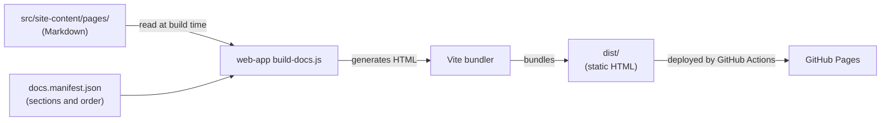

# Architecture Overview

> Living document. Reflects current system state. Updated after every pipeline run.
> Do not archive this file. Update it in place.

Last updated: 0000005-ravintio-docs-rewrite

---

## System Summary

The RAVINTIO docs system is a static site on GitHub Pages at `https://ravintio.github.io`. Authors write Markdown pages. A Node script turns them into HTML at build time, and Vite bundles the result. GitHub Actions deploys it when a change merges to `main`. The system has no backend, no sign-in, and no stored user data.

---

## Components

| Component | Type | Purpose | Status |
|-----------|------|---------|--------|
| `site-content` | content | Owns the Markdown pages | active |
| `web-app` | static site | Builds and serves the site, owns the nav manifest and tests | active |

---

## Communication Patterns

---

## Data Ownership

| Data Store | Owner | Consumers |
|------------|-------|-----------|
| `src/site-content/pages/*.md` | `site-content` | `web-app`, read only at build time |
| `src/web-app/docs.manifest.json` | `web-app` | `web-app` build script and Vite config |

---

## External Dependencies

| Dependency | Type | Components That Use It |
|------------|------|----------------------|
| GitHub Pages | hosting | `web-app` |
| GitHub Actions | CI/CD | `web-app` |
| Vite 7 | npm | `web-app` |
| marked 17 | npm | `web-app` |
| mermaid 11 | npm | `web-app`, loaded only on pages with diagrams |

---

## Key Architectural Decisions

See `docs/decisions-index.md` for the full list. These decisions shape the current architecture:

- Static site generation with Vite, with no backend (website ADR-001).
- `site-content` owns the pages, and `web-app` only reads them (0000005 ADR-002).
- A sectioned manifest sets the nav sections and page order (0000005 ADR-003).
- Tests guard the brand and keep the reference pages in step with the pack (0000005 ADR-004 and ADR-005).

---

*Template: architecture-overview.template.md*
