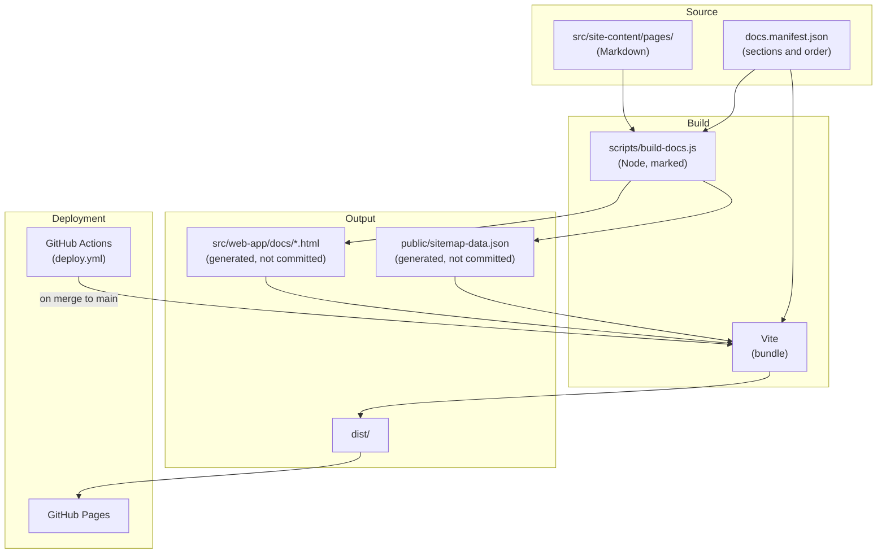

# Dependency Graph

Last updated: 0000009-bug-fixes

---

## Build Pipeline

---

## Test Inputs

| Test | Reads |
|------|-------|
| `nav.test.mjs` | `docs.manifest.json`, `dist/docs/*.html` |
| `brand-guard.test.mjs` | Every tracked file, `dist/` |
| `capitals.test.mjs` | Pages, `index.html`, `dist/` |
| `links.test.mjs` | `dist/` |
| `style.test.mjs` | Pages |
| `status-labels.test.mjs` | `six-tools.md`, `what-is-ravintio.md` |
| `reference-match.test.mjs` | Reference pages, `ravintio-zero/skills/`, `standards/`, `templates/` |

---

## The installed pack

`ravintio-zero/` is a copy of the RAVINTIO Zero pack. It governs how this repo changes. The site build doesn't read it. Only `reference-match.test.mjs` reads it, to keep the reference pages accurate.
