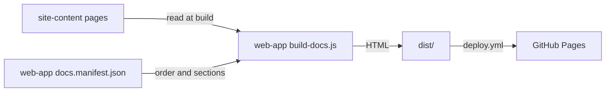

# Execution Plan - ravintio-docs-rewrite

> Every requirement must be traceable to a user story or acceptance criterion.

**Skill:** [plan](../skills/ravintio-plan/SKILL.md)
**Feature:** 0000005-ravintio-docs-rewrite
**Version:** 0.4.0
**Status:** active

## Active Skills

| Skill | Scope | Purpose |
|-------|-------|---------|
| none | plan | No capability skills are installed |

## Functional Requirements Directory

| File | Requirement |
|------|------------|
| [req-001-ravintio-overview.md](requirements/req-001-ravintio-overview.md) | Pages 1 and 2 explain RAVINTIO and the six tools with status labels |
| [req-002-zero-adoption-guide.md](requirements/req-002-zero-adoption-guide.md) | Pages 3 to 7 teach Zero adoption. Site-wide link and style checks. |
| [req-003-zero-reference.md](requirements/req-003-zero-reference.md) | Pages 8 to 10 list every pack skill, standard, and template |
| [req-004-brand-and-structure.md](requirements/req-004-brand-and-structure.md) | New component, sectioned nav, logo, and brand removal |

## Non-Functional Requirements

| ID | Category | Requirement | Target | Measurement |
|----|----------|------------|--------|-------------|
| NFR-001 | Accessibility | Pages meet WCAG 2.2 level AA | Text contrast at least 4.5:1, alt text on every image, nav usable by keyboard | Contrast ratio calculation for each theme colour pair, plus a manual keyboard pass at P3 |
| NFR-002 | Performance | Page weight on first load | Under 300 KB per page, excluding `mermaid` | Sum of `dist/` HTML, CSS, JS, and images each page loads |
| NFR-003 | Usability | Mobile layout | No horizontal scroll at 360 px wide | Browser check at 360 px at P3 |
| NFR-004 | Operability | Build time | `npm run build` under 60 s in CI | GitHub Actions build step duration, and local timing at P3 |
| NFR-005 | Security | No private strategy content in the repo | Zero matches for the strategy file and its private sections | Criterion 4 checklist at P3 |

## API Summary

Not applicable. The feature builds no API.

## Data Model Summary

| Entity | Owner Component | Key Fields | Relationships |
|--------|----------------|------------|--------------|
| page | site-content | file slug, first heading, body | Listed once in the `web-app` nav manifest |
| nav manifest | web-app | sections, section title, pages, file, title | References one page per entry |

## Component Interactions

## Test impact

| Cause | Test | Unit |
|-------|------|------|
| Skill count | none found (the run adds or removes no skill) | none |
| Skill-text budget | none found (the run edits no `SKILL.md`) | none |
| Size cap | none found (the run edits no measured skill) | none |
| Backlog entry id `0000004` | `ravintio-zero/tests/run-tests.sh`, `test-regression-pack.sh`, `regression/regression-manifest.json`, `regression/test-regression-pack.sh` match the pack's own history id `0000004`, not this repo's entry. No unit edits them. | none |

## Units

| Unit | Requirement | Work |
|------|-------------|------|
| U1 | REQ-004 | Tests for build, nav sections, brand guard, and capitals. Delete the old content folders. Move the build to `src/site-content/pages/`. Sectioned manifest and nav. Logo, favicons, homepage, page template, metadata, and `web-app` manifest and component docs. |
| U2 | REQ-004 | Repo docs, `plan/README.md`, `plan/feature-structure.md`, and the PowerShell refresh helper |
| U3 | REQ-001 | Pages 1 and 2, plus the status-label test |
| U4 | REQ-002 | Pages 3 to 7, plus the link and style tests |
| U5 | REQ-003 | Pages 8 to 10, plus the reference-match test |

## Concurrency plan

| Unit | Depends on | Writes | Batch | Sequential reason |
|------|-----------|--------|-------|-------------------|
| U1 | none | `src/web-app/**`, `planifest-docs/`, `src/planifest-docs/`, `graphics/` | 1 | Every page unit needs the new build path and nav sections first |
| U2 | U1 | `README.md`, `docs/*.md`, `plan/README.md`, `plan/feature-structure.md`, `refresh-*.ps1` | 2 | none |
| U3 | U1 | `src/site-content/pages/what-is-ravintio.md`, `src/site-content/pages/six-tools.md`, `src/web-app/tests/status-labels.test.mjs` | 2 | none |
| U5 | U1 | `src/site-content/pages/skills.md`, `src/site-content/pages/standards.md`, `src/site-content/pages/templates.md`, `src/web-app/tests/reference-match.test.mjs` | 2 | none |
| U4 | U3, U5 | `src/site-content/pages/zero-overview.md`, `install-zero.md`, `first-run.md`, `pipeline.md`, `project-operations.md`, `src/web-app/tests/links.test.mjs`, `src/web-app/tests/style.test.mjs` | 3 | The link and style tests cover every page, so they run after the other pages exist |

## Assumptions

| ID | Assumption | Impact if Wrong |
|----|-----------|----------------|
| A-001 | The human renames the GitHub repo before the first deploy | The site publishes at the old address |
| A-002 | The installed pack matches the published Zero release | Reference pages describe the wrong version |
| A-003 | RAVINTIO Framework is public at `github.com/RAVINTIO/ravintio-framework` | Its "Available" label misleads readers |
| A-004 | The logo reads well on the dark theme | The header needs a variant |

## Open Questions

| ID | Question | Blocking |
|----|----------|----------|
| none | | |
