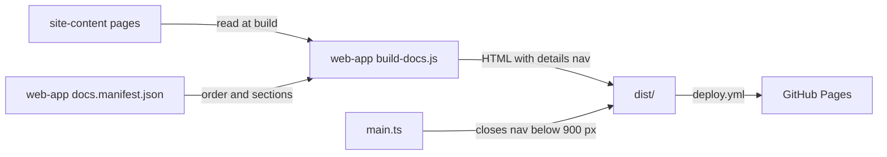

# Execution Plan - bug-fixes

> Every requirement must be traceable to a user story or acceptance criterion.

**Skill:** [plan](../skills/ravintio-plan/SKILL.md)
**Feature:** 0000009-bug-fixes
**Version:** 0.4.1
**Status:** active

## Active Skills

| Skill | Scope | Purpose |
|-------|-------|---------|
| none | plan | No capability skills are installed |

## Functional Requirements Directory

| File | Requirement |
|------|------------|
| [req-001-why-use-ravintio.md](requirements/req-001-why-use-ravintio.md) | "Why use RAVINTIO" leads `what-is-ravintio.md`. The name section goes and the principles shrink to three. |
| [req-002-simplicity-guidance.md](requirements/req-002-simplicity-guidance.md) | Simplicity guidance on `zero-overview.md` and `pipeline.md` |
| [req-003-zero-overview-reframe.md](requirements/req-003-zero-overview-reframe.md) | `zero-overview.md` leads with "Why use Zero", has "When Zero fits", and ends with "Terms" |
| [req-004-copy-fixes.md](requirements/req-004-copy-fixes.md) | First-run, install, six-tools, and homepage copy fixes |
| [req-005-mobile-section-nav.md](requirements/req-005-mobile-section-nav.md) | Page list collapses into a disclosure below 900 px |
| [req-006-dependency-advisories.md](requirements/req-006-dependency-advisories.md) | `npm audit` reports 0 advisories, with build and tests passing |

## Non-Functional Requirements

| ID | Category | Requirement | Target | Measurement |
|----|----------|------------|--------|-------------|
| NFR-001 | Usability | Mobile layout | No horizontal scroll at 360 px. The first page heading sits in the first viewport at 360 by 740 px. | Browser check at P3 |
| NFR-002 | Accessibility | Pages meet WCAG 2.2 level AA | The disclosure opens by keyboard and reports its expanded state | Keyboard pass and accessibility tree check at P3 |
| NFR-003 | Usability | Prose readability | Every sentence under 25 words, no blocklist terms | `style.test.mjs` |
| NFR-004 | Security | No known dependency advisories | 0 vulnerabilities | `npm audit` in `src/web-app` |

## API Summary

Not applicable. The feature builds no API.

## Data Model Summary

| Entity | Owner Component | Key Fields | Relationships |
|--------|----------------|------------|--------------|
| page | site-content | file slug, first heading, body | Listed once in the `web-app` nav manifest |
| nav manifest | web-app | sections, section title, pages, file, title | References one page per entry. Unchanged by this run. |

## Component Interactions

## Test impact

| Cause | Test | Unit |
|-------|------|------|
| Skill count | none found (the run adds or removes no skill) | none |
| Skill-text budget | none found (the run edits no `SKILL.md`) | none |
| Size cap | none found (the run edits no measured skill) | none |
| Backlog entry ids `0000007` and `0000008` | `ravintio-zero/tests/test-0000007-agent-optimisation.sh` and `test-0000199-req-001-003-reserve-ids-from-counter.sh` match the pack's own history ids, not this repo's entries. No unit edits them. | none |

## Units

| Unit | Requirement | Work |
|------|-------------|------|
| U1 | REQ-001 | `what-is-ravintio.md` intro, "Why use RAVINTIO", and principles. `six-tools.md` line 3. Test `why-use-ravintio.test.mjs`. |
| U2 | REQ-003 | `zero-overview.md` reframe. Test `zero-overview.test.mjs`. |
| U3 | REQ-005 | Disclosure in `build-docs.js`, `main.ts`, and `style.css`. Test `mobile-nav.test.mjs`. |
| U4 | REQ-002 | Simplicity section in `zero-overview.md` and the P2 sentence in `pipeline.md`. Test `simplicity.test.mjs`. |
| U5 | REQ-004 | `first-run.md`, `install-zero.md`, `six-tools.md` headings, and `index.html` subtitle. Test `copy-fixes.test.mjs`. |
| U6 | REQ-006 | `npm audit fix`, then `npm audit`, `npm run build`, and `npm test` |

## Concurrency plan

| Unit | Depends on | Writes | Batch | Sequential reason |
|------|-----------|--------|-------|-------------------|
| U1 | none | `src/site-content/pages/what-is-ravintio.md`, `src/site-content/pages/six-tools.md`, `src/web-app/tests/why-use-ravintio.test.mjs` | 1 | none |
| U2 | none | `src/site-content/pages/zero-overview.md`, `src/web-app/tests/zero-overview.test.mjs` | 1 | none |
| U3 | none | `src/web-app/scripts/build-docs.js`, `src/web-app/src/main.ts`, `src/web-app/src/style.css`, `src/web-app/tests/mobile-nav.test.mjs` | 1 | none |
| U4 | U2 | `src/site-content/pages/zero-overview.md`, `src/site-content/pages/pipeline.md`, `src/web-app/tests/simplicity.test.mjs` | 2 | none |
| U5 | U1 | `src/site-content/pages/first-run.md`, `src/site-content/pages/install-zero.md`, `src/site-content/pages/six-tools.md`, `src/web-app/index.html`, `src/web-app/tests/copy-fixes.test.mjs` | 2 | none |
| U6 | U3, U4, U5 | `src/web-app/package.json`, `src/web-app/package-lock.json` | 3 | It replaces `node_modules`, which every other unit builds and tests against |

## Assumptions

| ID | Assumption | Impact if Wrong |
|----|-----------|----------------|
| A-001 | `npm audit fix` within current majors changes no site behaviour | A build or rendering regression, caught by `npm test` and the P3 browser check |

## Open Questions

| ID | Question | Blocking |
|----|----------|----------|
| none | | |
