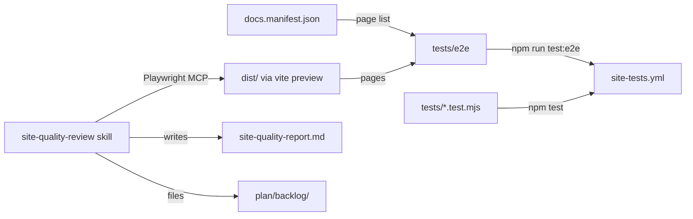

# Execution Plan - site-regression-and-quality

> Every requirement must be traceable to a user story or acceptance criterion.

**Skill:** [plan](../skills/ravintio-plan/SKILL.md)
**Feature:** 0000016-site-regression-and-quality
**Version:** 0.5.0
**Status:** active

## Active Skills

| Skill | Scope | Purpose |
|-------|-------|---------|
| none | plan | No capability skills are installed. U6 creates `site-quality-review`, and P3 uses it. |

## Functional Requirements Directory

| File | Requirement |
|------|------------|
| [req-001-page-health-suite.md](requirements/req-001-page-health-suite.md) | Playwright config and page health tests: status, console errors, links and anchors, and 390 px scroll |
| [req-002-interactive-behaviour-suite.md](requirements/req-002-interactive-behaviour-suite.md) | Theme toggle, mobile page list, and Mermaid tests, with a named skip when no page holds a diagram |
| [req-003-ci-site-tests.md](requirements/req-003-ci-site-tests.md) | `site-tests.yml` runs both suites on pull requests and keeps the report on failure |
| [req-004-playwright-mcp-config.md](requirements/req-004-playwright-mcp-config.md) | `.mcp.json` pins `@playwright/mcp` at `0.0.83` |
| [req-005-site-quality-review.md](requirements/req-005-site-quality-review.md) | The `site-quality-review` skill and repo instruction `custom-003` |
| [req-006-no-white-flash.md](requirements/req-006-no-white-flash.md) | Inline theme script and `color-scheme` meta tag in both templates |

## Non-Functional Requirements

| ID | Category | Requirement | Target | Measurement |
|----|----------|------------|--------|-------------|
| NFR-001 | Performance | Local Playwright suite run time | Under 60 s | Wall clock of `npm run test:e2e` against a build |
| NFR-002 | Performance | CI job run time | Under 5 min | GitHub Actions duration of the `site-tests.yml` job |
| NFR-003 | Reliability | Flaky tests | 0 | Three consecutive runs with `retries: 0` all pass |
| NFR-004 | Security | Workflow permissions | `contents: read` only | `node --test` check on `site-tests.yml` |
| NFR-005 | Usability | Prose readability | Every sentence under 25 words, no blocklist terms | `style.test.mjs` |

## API Summary

Not applicable. The feature builds no API.

## Data Model Summary

| Entity | Owner Component | Key Fields | Relationships |
|--------|----------------|------------|--------------|
| page | site-content | file slug, first heading, body | Listed once in the `web-app` nav manifest. Unchanged unless a fix-now finding needs it. |
| nav manifest | web-app | sections, section title, pages, file, title | The regression suite reads it for its page list |
| quality report | pipeline run | area, page, finding, evidence, sorting | One per run, archived at ship |
| backlog entry | pipeline run | id, slug, problem, suggested action | The review files one per backlog finding |

## Component Interactions

## Test impact

| Cause | Test | Unit |
|-------|------|------|
| Skill count | none found. Pack tests count `ravintio-zero/skills/`, and U6 adds a skill under `ravintio-overrides/capability-skills/`. | none |
| Skill-text budget | none found. The line-cap tests measure pack skills, not repo capability skills. | none |
| Size cap | none found. The run edits no measured skill. | none |
| Backlog entry ids `0000006` and `0000013` | `ravintio-zero/tests/test-0000006-build-assessment.sh` and its regression copy match the pack's own history id `0000006`, not this repo's entry. No match for `0000013`. | none |
| Capability skills folder | `test-0000005-pack-governance.sh` checks that `ravintio-overrides/capability-skills/.gitkeep` exists. U6 keeps it. | U6 |

## Units

| Unit | Requirement | Work |
|------|-------------|------|
| U1 | REQ-001 | Add `@playwright/test` `1.64.1`, `playwright.config.ts`, the `test:e2e` script, `.gitignore` entries, and `tests/e2e/page-health.spec.ts` |
| U2 | REQ-004 | `.mcp.json` and test `mcp-config.test.mjs` |
| U3 | REQ-002 | `tests/e2e/interactive.spec.ts` |
| U4 | REQ-006 | RED first: `tests/e2e/first-frame.spec.ts`. Then the inline script and meta tag in `index.html` and `build-docs.js`. |
| U5 | REQ-003 | `.github/workflows/site-tests.yml` and test `site-tests-workflow.test.mjs` |
| U6 | REQ-005 | Skill folder with `SKILL.md` and report template, repo instruction `custom-003`, test `quality-review.test.mjs`, then re-run setup with `--strict-orchestrator` to install them |
| U7 | all | `web-app` to `0.5.0` in `component.yml` and `package.json`. Update `component.yml`, `src/web-app/docs/`, and the living docs in `docs/` |

## Concurrency plan

| Unit | Depends on | Writes | Batch | Sequential reason |
|------|-----------|--------|-------|-------------------|
| U1 | none | `src/web-app/package.json`, `src/web-app/package-lock.json`, `src/web-app/playwright.config.ts`, `src/web-app/.gitignore`, `src/web-app/tests/e2e/page-health.spec.ts` | 1 | none |
| U2 | none | `.mcp.json`, `src/web-app/tests/mcp-config.test.mjs` | 1 | none |
| U6 | none | `ravintio-overrides/capability-skills/site-quality-review/`, `ravintio-overrides/instructions/custom-003-site-quality-review.md`, `src/web-app/tests/quality-review.test.mjs`, `.claude/skills/site-quality-review/`, `CLAUDE.md` | 1 | none |
| U3 | U1 | `src/web-app/tests/e2e/interactive.spec.ts` | 2 | none |
| U4 | U1 | `src/web-app/tests/e2e/first-frame.spec.ts`, `src/web-app/index.html`, `src/web-app/scripts/build-docs.js` | 2 | none |
| U5 | U1 | `.github/workflows/site-tests.yml`, `src/web-app/tests/site-tests-workflow.test.mjs` | 2 | none |
| U7 | U3, U4, U5, U6 | `src/web-app/component.yml`, `src/web-app/package.json`, `src/web-app/docs/`, `docs/` | 3 | It records the finished state of every other unit |

## Assumptions

| ID | Assumption | Impact if Wrong |
|----|-----------|----------------|
| A-001 | The white flash comes from the deferred module script that sets `data-theme` | The inline script fixes nothing. U4's RED test shows this before the fix. |
| A-002 | Playwright MCP stays available in the P3 session | The review stops with a `Blocked:` line |

## Open Questions

| ID | Question | Blocking |
|----|----------|----------|
| none | | |
