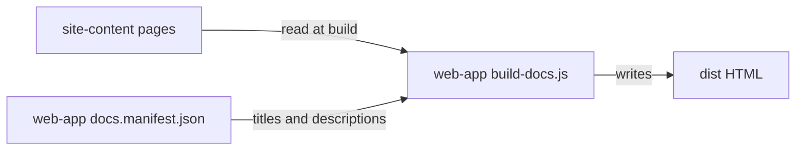

# Execution Plan - explainer-six-tools

> Every requirement must be traceable to a user story or acceptance criterion.

**Skill:** [plan](../skills/ravintio-plan/SKILL.md)
**Feature:** 0000024-explainer-six-tools
**Version:** 0.6.0
**Status:** active

## Active Skills

| Skill | Scope | Purpose |
|-------|-------|---------|
| site-quality-review | permanent | Reviews the built site in P3 |

## Functional Requirements Directory

| File | Requirement |
|------|------------|
| [req-001-explainer-six-tools.md](requirements/req-001-explainer-six-tools.md) | Rebalance the explainer and subtitle to all six tools |
| [req-002-meta-descriptions.md](requirements/req-002-meta-descriptions.md) | Add a unique meta description to each doc page |
| [req-003-active-voice.md](requirements/req-003-active-voice.md) | Remove passive sentences and add a voice check |

The design lists eight criteria. The requirements hold them as seven checkbox lines:

| Design criterion | Requirement criterion |
|------------------|-----------------------|
| US-001 AC-1, AC-3 | REQ-001 AC-1 |
| US-001 AC-2 | REQ-001 AC-2 |
| US-001 AC-4 | REQ-001 AC-3 |
| US-002 AC-1 | REQ-002 AC-1 |
| US-002 AC-2 | REQ-002 AC-2 |
| US-003 AC-1 | REQ-003 AC-1 |
| US-003 AC-2 | REQ-003 AC-2 |

## Non-Functional Requirements

| ID | Category | Requirement | Target | Measurement |
|----|----------|------------|--------|-------------|
| NFR-001 | Performance | Page weight stays low | Each page under 500 KB | Playwright page health suite |
| NFR-002 | Maintainability | Unit tests stay fast | `npm test` under 10 s locally | `node --test` run time |
| NFR-003 | Readability | Prose meets the style test | 0 sentences over 24 words, 0 voice hits outside the allowlist | `style.test.mjs` |

## API Summary

Not applicable. The feature builds no API.

## Data Model Summary

| Entity | Owner Component | Key Fields | Relationships |
|--------|----------------|------------|--------------|
| Manifest page entry | web-app | `file`, `title`, `description` | One per page Markdown file in `site-content` |

## Component Interactions

## Test impact

| Cause | Test | Unit |
|-------|------|------|
| Skill count | none found: the run adds no skill | none |
| Skill-text budget | none found: the run edits no `SKILL.md` | none |
| Size cap | none found | none |
| Backlog entry id 0000017, 0000021, 0000023 | none found: the `ravintio-zero/tests/` matches name pack feature ids, not these backlog entries | none |
| Pinned explainer text | `src/web-app/tests/why-use-ravintio.test.mjs` | U1 |
| Pinned subtitle text | `src/web-app/tests/copy-fixes.test.mjs` | U1 |
| Pinned anchor link | `src/web-app/tests/zero-overview.test.mjs` | U1 |

## Concurrency plan

Every unit rebuilds `src/web-app/dist/` and the Playwright suite uses preview port 4173. These shared resources force a sequence.

| Unit | Depends on | Writes | Batch | Sequential reason |
|------|-----------|--------|-------|-------------------|
| U1 | none | `src/site-content/pages/what-is-ravintio.md`, `src/site-content/pages/zero-overview.md`, `src/web-app/index.html`, `src/web-app/tests/explainer.test.mjs`, `src/web-app/tests/why-use-ravintio.test.mjs`, `src/web-app/tests/copy-fixes.test.mjs`, `src/web-app/tests/zero-overview.test.mjs` | 1 | It shares `dist/` and port 4173 with U2 |
| U2 | U1 | `src/web-app/docs.manifest.json`, `src/web-app/scripts/build-docs.js`, `src/web-app/tests/meta-descriptions.test.mjs` | 2 | It shares `dist/` and port 4173 with U1 and U3 |
| U3 | U1 | `src/web-app/tests/style.test.mjs`, `src/site-content/pages/*.md` | 3 | It edits `what-is-ravintio.md` after U1, and shares `dist/` with U2 |
| U4 | U1, U2, U3 | `src/web-app/component.yml`, `src/site-content/component.yml`, `src/web-app/docs/`, `src/site-content/docs/`, `docs/` | 4 | It records the finished state of every other unit |

## Assumptions

| ID | Assumption | Impact if Wrong |
|----|-----------|----------------|
| A-001 | The Zero overview covers Zero's benefits, so the explainer can drop the ten bullets. | Readers lose points such as "No lock-in". |
| A-002 | The homepage meta description stays and differs from every page description. | REQ-002 AC-2 fails. |

## Open Questions

None.
