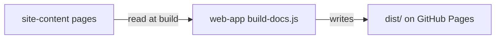

# Execution Plan - site-quality-fixes

> Every requirement must be traceable to a user story or acceptance criterion.

**Skill:** [plan](../skills/ravintio-plan/SKILL.md)
**Feature:** 0000027-site-quality-fixes
**Version:** 0.7.0
**Status:** active

## Active Skills

| Skill | Scope | Purpose |
|-------|-------|---------|
| site-quality-review | permanent | P3 review of the built site, which now reads the axe report |

## Functional Requirements Directory

| File | Requirement |
|------|------------|
| [req-001-axe-scans.md](requirements/req-001-axe-scans.md) | Scan every page in both themes with axe-core |
| [req-002-custom-404-page.md](requirements/req-002-custom-404-page.md) | Add a 404 page that works at any depth |
| [req-003-homepage-main-landmark.md](requirements/req-003-homepage-main-landmark.md) | Add a homepage `<main>` and check one per page |
| [req-004-phone-text-width.md](requirements/req-004-phone-text-width.md) | Widen the text column on phones |
| [req-005-pin-actions-by-sha.md](requirements/req-005-pin-actions-by-sha.md) | Pin the site workflow actions by SHA |
| [req-006-organisation-code-link.md](requirements/req-006-organisation-code-link.md) | Point the code links to the RAVINTIO organisation |
| [req-007-active-voice-table-cell.md](requirements/req-007-active-voice-table-cell.md) | Name the actor in one table cell |

## Non-Functional Requirements

| ID | Category | Requirement | Target | Measurement |
|----|----------|------------|--------|-------------|
| NFR-001 | Accessibility | No severe axe violations | Zero serious or critical violations on every page in both themes | `axe.spec.ts` in CI |
| NFR-002 | Performance | Page weight unchanged | Under 500 KB per page | Built `dist/` sizes |
| NFR-003 | Usability | Phone line length | Body text at least 330 px wide at 390 px, no sideways scroll | `page-health.spec.ts` |
| NFR-004 | Security | Pinned CI actions | Every `uses:` in `site-tests.yml` and `deploy.yml` holds a 40-character SHA | `site-tests-workflow.test.mjs` |

## API Summary

Not applicable. The site is static and has no API.

## Data Model Summary

No data model change. `site-content` owns the page Markdown. `web-app` owns the shell, build, and workflows.

## Component Interactions

## Test impact

| Cause | Test | Unit |
|-------|------|------|
| Skill count | none found: the run adds no skill | none |
| Skill-text budget | none found: the run edits no `SKILL.md` | none |
| Size cap | none found | none |
| Backlog entry id 0000015, 0000018, 0000019, 0000020, 0000022, 0000025, 0000026 | none found: the `ravintio-zero/tests/` matches name pack feature ids, not these entries | none |
| Workflow text checks | `src/web-app/tests/site-tests-workflow.test.mjs` | U2 |
| One-`<main>` and 390 px checks | `src/web-app/tests/e2e/page-health.spec.ts` | U3, U6 |
| Page list for scans | `src/web-app/tests/e2e/pages.ts` | U5 |

## Concurrency plan

Units map to requirements: U1 REQ-007, U2 REQ-005, U3 REQ-003, U4 REQ-006, U5 REQ-002, U6 REQ-004, U7 REQ-001, and U8 the docs.

Units that build `src/web-app/dist/` or use preview port 4173 run alone in their batch. U1 and U2 run Node tests only, so they share batch 1 with U3.

| Unit | Depends on | Writes | Batch | Sequential reason |
|------|-----------|--------|-------|-------------------|
| U1 | none | `src/site-content/pages/project-operations.md`, `src/web-app/tests/ops-table-cell.test.mjs` | 1 | none |
| U2 | none | `.github/workflows/site-tests.yml`, `.github/workflows/deploy.yml`, `src/web-app/tests/site-tests-workflow.test.mjs` | 1 | none |
| U3 | none | `src/web-app/index.html`, `src/web-app/tests/e2e/page-health.spec.ts` | 1 | none |
| U4 | U3 | `src/web-app/index.html`, `src/web-app/scripts/build-docs.js`, `src/web-app/tests/org-link.test.mjs` | 2 | It edits `index.html` after U3 and rebuilds `dist/` |
| U5 | U4 | `src/web-app/404.html`, `src/web-app/vite.config.ts`, `src/web-app/tests/e2e/pages.ts`, `src/web-app/tests/e2e/not-found.spec.ts`, `src/web-app/tests/org-link.test.mjs` | 3 | Its header copies the U4 link, and it rebuilds `dist/` |
| U6 | U3 | `src/web-app/src/style.css`, `src/web-app/tests/e2e/page-health.spec.ts` | 4 | It edits `page-health.spec.ts` after U3 and uses port 4173 |
| U7 | U5, U6 | `src/web-app/package.json`, `src/web-app/package-lock.json`, `src/web-app/tests/e2e/axe.spec.ts`, `src/web-app/src/style.css`, markup fixes the scan needs | 5 | It scans the pages the other units change, and only it adds a dependency |
| U8 | U1, U2, U3, U4, U5, U6, U7 | `src/web-app/component.yml`, `src/site-content/component.yml`, `src/web-app/docs/`, `src/site-content/docs/`, `docs/` | 6 | It records the finished state of every other unit |

## Assumptions

| ID | Assumption | Impact if Wrong |
|----|-----------|----------------|
| A-001 | The site serves from the root of `ravintio.github.io`. | The 404 page assets fail to load. |
| A-002 | The first axe scan surfaces few serious violations. | U7 grows past 4 points. |

## Open Questions

| ID | Question | Blocking |
|----|----------|----------|
| none | | |
